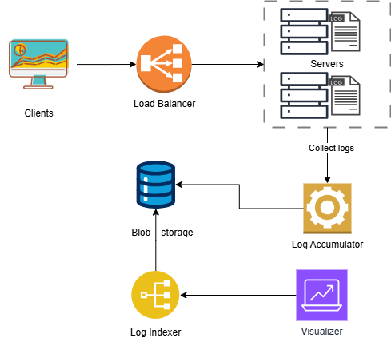
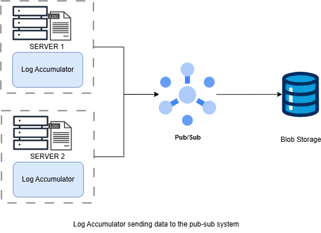

# Designing Distributed Logging System

One of the most challenging aspects of debugging distributed systems is understanding system behavior in the period leading up to a bug.
As we all know by now, a distributed system is made up of microservices calling each other to complete an operation.
Multiple services can talk to each other to complete a single business requirement.

In this architecture, logs are accumulated in each machine running the microservice. A single microservice can also be deployed to hundreds of nodes. In an archirectural setup where multiple microservices are interdependent, and failure of one service can result in failures of other services. If we do not have well organized logging, we might not be able to determine the root cause of failure.

## Understanding the system
### Restrain Log Size
At any given time, the distributed system logs hundreds of concurrent messages.
The number of logs increases over time. But, not all logs are important enough to be logged.
To solve this, logs have to be structured. We need to decide what to log into the system on the application or logging level.

### Log sampling
Storage and processing resources is a constraint. We must determine which messages we should log into the system so as to control volume of logs generated.

High-throughput systems will emit lots of messages from the same set of events. Instead of logging all the messages, we can use a sampler service that only logs a smaller set of messages from a larger chunk. The sampler service can use various sampling algorithms such as adaptive and priority sampling to log events. For large systems with thousands of microservices and billions of events per seconds, an appropriate

### Structured logging
The first benefit of structured logs is better interoperability between log readers and writers.
Use structured logging to make the job of log processing system easier.

### Categorization
The following severity levels are commonly used in logging:
- `DEBUG`
- `INFO`
- `WARNING`
- `ERROR`
- `CRITICAL`

## Requirements
### Functional requirements
- Writing logs: the microservices should be able to write into the logging system.
- Query-based logs: It should be effortless to search for logs.
- The logs should reside in distributed storage for easy access.
- The logging mechanism should be secure and not vulnerable. Access to logs should be for authenticated users and necessary read-only permissions granted to everyone.
- The system should avoid logging sensitive information like credit cards numbers, passwords, and so on.
- Since logging is a I/O-heavy operation, the system should avoid logging excessive information. Logging all information is unnecessary. It only takes up more space and impacts performance.
- Avoid logging personally identifiable information (PII) such as names, addresses, emails, etc.


### Non-functional requirements
- **Low latency:** bound logging overhead and queue sizes. Best-effort diagnostics can favor nonblocking calls; logs requiring durable acceptance may need additional latency, backpressure, or explicit rejection.
- **Scalability:** Our logging system must be scalable. It should efficiently handle increasing log volumes over time and support a growing number of concurrent users.
- **Availability:** specify which failures can prevent durable acceptance and whether the application then continues, drops diagnostic records, or fails the operation. Finite resources cannot provide lossless, nonblocking logging through an indefinitely unavailable sink.

## Components to use
We will use the following components:
- **Pub-Sub system:** we will use a publish-subscribe system to efficiently handle the large volume of logs.
- **Distributed Search:** we will employ distributed search to query logs efficiently.

>A distributed search system is a search architecture that efficiently handles large dataset and high query loads by spreading search operations across multiple servers or nodes. It has the following components:
>1. **Crawler:** This component fetches the content and creates documents.
>2. **Indexer:** Builds a searchable index from the fetched documents.
>3. **Searcher:** Responds to user queries by running searches on the index created by the indexer.

- **Logging Accumulator:** This component will collect logs from each node and store them in a central location, allowing for easy retrieval of logs related to specific events without needing to query each individual node.
- **Blob Storage:** The blob storage provides a scalable and reliable storage for large volumes of data.
- **Log Indexer:** Due to the increasing number of log files, efficient searching is crucial. The log indexer utilizes distributed search techniques to index and make logs searchable, ensuring fast retrieval of relevant information.
- **Visualizer:** The visualizer component provides a unified view of all logs. It enables users to analyze and monitor system behavior and performance through visual representation and analytics.


## API Design
We design for reads and writes


Read
```python
searching(keyword)
```
This API call returns a list of logs that contain the keyword.

Write
```python
write_logs(unique_ID, message)
```
This API call writes the log message against against a unique key.


## High Level System Design



## Component Design

### Logging at Various Levels in a Server
In a server environment, logging occurs across various services and application, each producing logs crucial for monitoring and troubleshooting.

#### Server Level
- **Multiple Applications:** A server hosts multiple apps, such as App1, App2, etc. Each running various microservices with user authentication, fetching the cart, storage etc in an e-commerce context.
- **Event identity:** application ID, service ID, and timestamp are not a unique key: two instances can emit at the same timestamp. Generate an `event_id` once and retain it across delivery retries. One design uses an assigned unique producer-incarnation ID plus a sequence number; never reuse an incarnation ID after resetting its sequence.
- **Time and causality:** record event time separately from the collector's observed time. Clock skew can place a causal receive before its send when sorting timestamps. Trace and span IDs connect logs to instrumented operations; parent relationships in trace data explain those operations' causal structure, not every event in the system. The [OpenTelemetry log model](https://opentelemetry.io/docs/specs/otel/logs/data-model/) distinguishes timestamps and trace/span identifiers.

#### Logging Process
Each service will push logs into the log accumulator service.
The service will store the logs logically and push the logs to a pub-sub system.

We use the pub-sub system to handle scalability challenge by efficiently managing and distributing a large volume of logs across the system.

#### Ensuring Low Latency and Performance
- **Asynchronous logging:** background work moves I/O off the request path, but still consumes CPU, memory, network, and storage. Use a bounded queue and define what happens when it fills: drop with observable counts, block, or reject according to the log's purpose. Low-priority workers can fall behind; asynchronous does not mean zero impact.
- **Data loss awareness:** records accepted only into RAM can be lost when that process crashes. More accumulators can relieve load but do not protect an individual volatile queue. A process-persistent spool is not protection against loss of its host or disk.
- **Acceptance boundary:** distinguish an in-memory enqueue, a persisted spool, a replicated broker acknowledgment, a completed archive write, and search visibility. If a caller needs durable acceptance, acknowledge only after the chosen persistence boundary under its stated failure assumptions. This adds persistence cost and requires retry/backpressure behavior; a successful enqueue alone is not that acknowledgment.

#### Log Retention
Logs also have an expiration date. We can delete regular logs after a few days or months. Comliance logs are usually stored for up to five years. If depends on the requirements of the application.

Another crucial component therefore is to have an expiration checker. It will verity the logs that have to be deleted

### Data Center Level
All servers in the data center transmit logs to a publish-subscribe architecture.
By utilizing a horizontally-scalable pub-sub framework, we can effectively manager large log volumes.

Implementing multiple pub-sub instance within each data center enhances scalability and prevents throughput limitations and bottlenecks. Subsequently, the pub-sub system routes the log data to blob storage.



Archive records before their broker copies become eligible for deletion. For each partition, durably write and verify a contiguous prefix before advancing its archival checkpoint past that prefix. A crash after the sink write but before the checkpoint causes replay, so use idempotent writes or durable deduplication keyed by stable batch/event identifiers.

A consumer checkpoint does not prevent normal time- or size-based broker deletion; [Kafka's topic retention policies](https://kafka.apache.org/41/configuration/topic-configs/) are one example. Either coordinate retirement with verified archive coverage or provision and monitor retention time and byte capacity covering the declared outage and recovery period. Once retention overtakes unarchived data, an offset cannot recover it.

For an illustrative decimal-byte budget, assume zero initial lag, 10 MB/s admitted input, and a 30-minute archive outage. The backlog is `10 * 1800 = 18,000 MB = 18 GB`. Recovery at 15 MB/s drains it at only `15 - 10 = 5 MB/s`, taking another `3600 seconds`. A conservative retention budget exceeds the combined 90 minutes, plus headroom. At equal input and archive rates, existing lag does not shrink. Below the input rate, archive throughput cannot prevent growing lag and eventual exhaustion of finite retention.

Archival completion is separate from index and alert freshness. Monitor archive lag, retention headroom, ingest-to-search delay, and ingest-to-alert delay. While records remain in the broker, independent consumers can provide:
- **Alerts Service:** This service identifies alerts and errors and notifies the appropriate stakeholders if a critical error is detected, or sends a message to a monitoring tool, ensuring timely awareness of important alerts. The service will also monitor logs for suspicious activities or security incidents, triggering alerts or automated responses to mitigate threats.
- **Analytics service:** This service analyzes trends and patterns in the logged data to provide insights into system perf, user behavior, or operational metrics.
